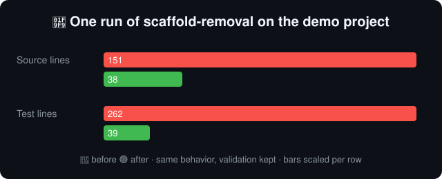

# 🧹 scaffold-removal

**Your agent built the feature. Now make it reviewable.**

[](LICENSE)



An agent skill that pares a finished feature back to what a reviewer needs to
see. Run it once the code works and before you open the pull request.

> 🙋 **Contributions welcome.** Try it on your own code, then open an issue or
> PR with what it cut well, what it cut wrongly, and what it missed.

## 🤔 Why

Agents write a lot of code, even with skills that tell them to write less. Code
and tests are added as the feature grows, and a lot of scaffolding goes up to
reach a working MVP: abstractions for formats nobody ended up using, options
nobody sets, debug logging, and unit tests that mirror the implementation.

Once the MVP works, much of that is cruft. It makes the diff bigger, the review
slower, and the result harder to maintain. Skills that restrain the agent while
it writes (such as [ponytail](https://github.com/DietrichGebert/ponytail)) help,
but they cannot remove what was only needed on the way. This skill is the second
pass: **YAGNI, applied after the proof of concept.** Keep the working
integration, not the history of how it was developed.

It deletes dead wrappers, speculative options, single-use abstractions and
debug code, and replaces overlapping unit tests with one end-to-end smoke test.
It keeps input validation, error handling and other safeguards, asks before
changing behavior anyone may rely on, and does not commit. It ends with a short
report for the reviewer. See [SKILL.md](skills/scaffold-removal/SKILL.md) for
the details, and [demo/](demo/README.md) for a real before/after run.

## 📦 Install

The skill is one file: [skills/scaffold-removal/SKILL.md](skills/scaffold-removal/SKILL.md).
Copy the `scaffold-removal` folder into your agent's skills directory.

**GitHub Copilot** (VS Code and CLI), for one project or for all of them:

```powershell
git clone https://github.com/gastoneb/scaffold-removal
Copy-Item scaffold-removal\skills\scaffold-removal .github\skills\ -Recurse   # this project
Copy-Item scaffold-removal\skills\scaffold-removal ~\.copilot\skills\ -Recurse # all projects
```

**Claude Code:** the same folder goes in `.claude/skills/` (project) or
`~/.claude/skills/` (all projects).

**Any other agent:** paste the body of `SKILL.md` into your rules file
(`AGENTS.md`, Cursor rules, and so on). It is plain instructions, with no code
or dependencies.

Restart the session after installing so the agent notices the new skill.

## 🚀 Use

- Ask in plain words: "remove the scaffolding", "pare this down for review".
  The description in `SKILL.md` lets the agent load the skill on its own.
- Or invoke it by name where your agent supports it, for example
  `/scaffold-removal` in Copilot and Claude Code, or `$scaffold-removal` in
  Codex. Slash-command support varies by agent and version.

Run it as the last step before pushing, then read the agent's report and the
diff. The skill cuts aggressively by design; you decide what stays.

## 📄 License

[MIT](LICENSE)
